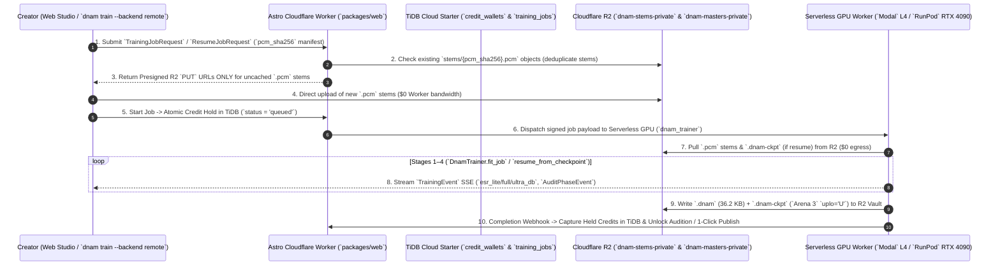

# 4-Stage Deterministic Training Pipeline & Single-Checkpoint (`.dnam-ckpt`) Iterative Resume

DNAM replaces cold random initialization and fragile single-precision normal equations with a **4-Stage Deterministic System-Identification & Export Polish Pipeline** paired with **Single-Checkpoint (`.dnam-ckpt`) Two-Tier Iterative Stem Expansion**.

---

## 1. The 4-Stage Deterministic Training Pipeline

### Stage 1 — Step-0 Per-Stem System-ID, Pre-Flight Audit & Order-Statistic Transport
Before Epoch 1 begins ($< 200\text{ ms}$ total runtime):
1. Runs **Phase 1 of the Non-Stop Control-Space Audit** (`[CLAMP-RANGE]`, `[CLAMP-SWITCH]`, `[CLAMP-STABILITY]`; see [`clamp_and_audit_registry.md`](clamp_and_audit_registry.md)), emitting live console/UI warnings without blocking execution.
2. Extracts sorted delay times $\tau_{0,1}^{(s)} < \dots < \tau_{0,M}^{(s)}$, LFO frequencies $f_{\text{lfo},j}^{(s)}$, decay gains $g_{\text{lin},m}^{(s)}$, and log-octave poles $f_{0,c} = 25 \cdot (16000/25)^{c/(C-1)}$ across all stems $s \in \{1, \dots, S\}$.
3. Computes the Step-0 Physical Variance Gates $\mathbf{G}_p \in \{0, 1\}$ (`CL-14`) and solves the Node-Anchored Newton/Lobatto control map in closed form.

### Stage 2 — Step-0 SVD-Orthonormal Kronecker `float64` Wiener-Hopf Warm-Start (`CL-18`)
1. **Orthonormal SVD Principal Control Subspace Projection (`CL-18`):**
   User-supplied stem metadata often contains redundant or collinear controls (e.g., `Master` swept identically to `Gain`, or sparse combinations). Evaluating the SVD of the stem control basis matrix $\boldsymbol{\Psi}_{\text{stems}} = \mathbf{U}_{\text{svd}} \boldsymbol{\Sigma}_{\text{svd}} \mathbf{V}_{\text{svd}}^\top$ and retaining only singular vectors with $\sigma_k > 10^{-4}$ (up to rank $D_h \le 4$) yields the orthonormal control projector $\mathbf{P}_{\text{svd}} \in \mathbb{R}^{D_{\text{basis}} \times D_h}$:
   $$\mathbf{z}_{\text{head}}(\mathbf{u}, \mathbf{s}) = \mathbf{P}_{\text{svd}}^\top \boldsymbol{\psi}_{\text{raw}}(\mathbf{u}, \mathbf{s}) \in \mathbb{R}^{D_h}$$
2. **Step-0 `float64` Kronecker Normal Equations ($\lambda_{\text{init}} = 10^{-3}\bar{\tau}$):**
   For each stem $s$, extract the 16-tap unfolded Core 1 feature matrix $\mathbf{\Phi}_s \in \mathbb{R}^{L_s \times 16C}$ and compute its un-entangled per-stem `float64` sufficient statistics:
   $$\mathbf{G}_{\text{audio}}^{(s)} = \mathbf{\Phi}_s^\top \mathbf{\Phi}_s \in \mathbb{R}^{16C \times 16C}, \qquad \mathbf{C}_{\text{audio}}^{(s)} = \mathbf{\Phi}_s^\top \mathbf{Y}_s \in \mathbb{R}^{16C \times 2}$$
   Assemble the global Kronecker Gram matrix via $\tilde{\boldsymbol{\psi}}_s = [1, \mathbf{z}_{\text{head}}(\mathbf{u}_s, \mathbf{s}_s)^\top]^\top \in \mathbb{R}^{1 + D_h}$:
   $$\mathbf{G}_0 = \sum_{s=1}^S \mathbf{G}_{\text{audio}}^{(s)} \otimes \big(\tilde{\boldsymbol{\psi}}_s \tilde{\boldsymbol{\psi}}_s^\top\big), \qquad \mathbf{C}_0 = \sum_{s=1}^S \mathbf{C}_{\text{audio}}^{(s)} \otimes \tilde{\boldsymbol{\psi}}_s$$
   Using the **conservative warm-start ridge** $\lambda_{\text{init}} = 10^{-3} \frac{\operatorname{tr}(\mathbf{G}_0)}{\dim(\mathbf{G}_0)}$ (`CL-18`) prevents collinear feature explosion during subsequent backbone updates and drops Step-0 ESR from **$+0.01\text{ dB} \to -25.39\text{ dB}$** before a single gradient step is taken (`Test 7B`).

### Stage 3 — `Adam(weight_decay = 0.0)` + 20-Step Warmup + Surrogate Delay Gradient
1. **Why `Adam(weight_decay = 0.0)` Is Mandatory Over `AdamW`:**
   After the Step-0 Wiener-Hopf solve places $\mathbf{W}_{\text{head}}$ at its analytical optimum, standard `AdamW` multiplicative weight decay ($\lambda_{\text{wd}} = 10^{-2}$) immediately shrinks $\mathbf{W}_{\text{head}}$ toward zero at Step 1, destroying the warm-start ($-25.39\text{ dB} \to -5.3\text{ dB}$). Using `Adam(weight_decay = 0.0)` with a 20-step linear learning-rate warmup and $3\times$ lower head LR ($3 \times 10^{-4}$ vs. $10^{-3}$) ensures **strictly monotonic ESR improvement**.
2. **Envelope-Guided Multi-Scale Surrogate Delay Gradient (`Test 6`):**
   Standard 4-tap Cubic Lagrange delay gradients have a 4-sample support and get trapped in wrong sinusoidal carrier-cycle local minima whenever $|\tau_{\text{init}} - \tau_{\text{true}}| > \frac{T_0}{2}$ ($54.52\text{-sample}$ error in `Test 6`). During the first $45\%$ of epochs, `backward()` replaces the myopic Lagrange derivative with a **Multi-Scale Gaussian Derivative Envelope Surrogate** ($\sigma_{\text{grad}}: 35.0 \to 0.0\text{ samples}$) evaluated on $|s_m[n]|$:
   $$g_{\text{surr}}[k] \propto \frac{k}{\sigma_{\text{grad}}^2} \exp\!\left(-\frac{k^2}{2\sigma_{\text{grad}}^2}\right)$$
   which creates a convex basin across $> 200\text{ samples}$ and locks to **$0.0035\text{ samples}$** once handed off to the exact Cubic Lagrange gradient.
3. **Per-Stem `State-Carry TBPTT` & Stop-Gradient Corner Barrier ($\mathcal{L}_{\text{barrier}}$):**
   Maintains a dedicated VRAM state slot $(\mathbf{z}_{\text{ssm}}^{(s)}, \mathbf{s}_{\text{fdn}}^{(s)}, \mathbf{m}_{\text{ctrl}}^{(s)})$ per stem $s$ across contiguous $L = 32,768$-sample TBPTT windows (with a $2,048$-sample burn-in prefix) while evaluating the Phase-2 Stop-Gradient Corner Barrier loss $\mathcal{L}_{\text{barrier}}$ at every step.

### Stage 4 — Step-$N$ `float64` Cholesky Export Polish ($\lambda_{\text{polish}} = 10^{-6}\bar{\tau}$)
At the end of training, freeze the nonlinear backbone, recompute the exact per-stem `float64` audio matrices $\{\mathbf{G}_{\text{audio}}^{(s)}, \mathbf{C}_{\text{audio}}^{(s)}\}$ over the full training stems, and solve the global Kronecker normal equations with the **tight polish ridge** $\lambda_{\text{polish}} = 10^{-6}\bar{\tau}$ (`CL-18`). In `Test 7B`, this final polish drops stereo ESR from **$-27.23\text{ dB} \to -47.63\text{ dB}$ ($0.0017\%$ error)** in $< 50\text{ ms}$!

---

## 2. Single-Checkpoint (`.dnam-ckpt`) Two-Tier Iterative Stem Expansion

> [!IMPORTANT]
> **Why Only ONE `.dnam-ckpt` File Is Needed & Why It Stores Tier-Ordered Upper-Triangular Per-Stem Audio Matrices $\{\operatorname{pack}_{\text{U}}(\mathbf{G}_{\text{audio}}^{(s)}), \mathbf{C}_{\text{audio}}^{(s)}\}$:**
> Training runs **non-stop** to completion and outputs:
> 1. The finished, playable `.dnam` Hybrid Binary Container (with any necessary safety clamps active).
> 2. A **Consolidated Audit & Stem Prescription Report** telling the user which optional stems would lift any active clamps.
> 3. **One single deduplicated, `pickle`-free `.dnam-ckpt` file** (`magic = b"DNCK"`) whose `Arena 0..2` are bit-identical to the `.dnam` weights, followed by `Arena 3` containing the **tier-ordered Column-Major Upper-Triangular (`uplo='U'`) `float64` audio sufficient statistics** $\{\operatorname{pack}_{\text{U}}(\mathbf{G}_{\text{audio}}^{(s)}),\; \mathbf{C}_{\text{audio}}^{(s)}\}$ (**only $17.25\text{ KB/stem}$ at $C=4$ `Lite`, $66.50\text{ KB/stem}$ at $C=8$ `Full`, or $147.75\text{ KB/stem}$ at $C=12$ `Ultra`—cutting symmetric Gram storage in half while keeping `Lite` ($2,080\text{ f64}$) and `Full` ($8,256\text{ f64}$) as exact contiguous prefixes of the $18,528\text{-element}$ `Ultra` packed upper triangle; see [`dnam_container_schema.md` §6.2](dnam_container_schema.md#62-tier-ordered-column-major-upper-triangular-packing-uplou-for-mathbfg_textaudios)**).

### Why Pre-Summed Kronecker Matrices Fail on Stem Additions (Mathematical Proof)
If `.dnam-ckpt` stored only the pre-collapsed sum $\mathbf{G}_{\text{old}} = \sum_{s=1}^S \mathbf{G}_{\text{audio}}^{(s)} \otimes (\tilde{\boldsymbol{\psi}}_s \tilde{\boldsymbol{\psi}}_s^\top)$, then adding a new stem $s_{\text{new}}$ that:
- increases a knob's polynomial degree $K_p$ (e.g., $1 \to 2$ or $2 \to 3$),
- unlocks a previously unobserved `switch` option, or
- rotates the SVD principal control subspace projector $\mathbf{P}_{\text{svd}} \to \mathbf{P}_{\text{svd,new}}$
would **invalidate $\mathbf{G}_{\text{old}}$** because the old control vectors $\tilde{\boldsymbol{\psi}}_s$ were already multiplied and summed inside $\mathbf{G}_{\text{old}}$!

By storing the **audio-only** matrices $\{\mathbf{G}_{\text{audio}}^{(s)}, \mathbf{C}_{\text{audio}}^{(s)}\}$ per stem $s$, the trainer can recompute $\mathbf{P}_{\text{svd,new}}$ and updated control vectors $\tilde{\boldsymbol{\psi}}_s^{\text{new}}$ for **all old and new stems in microseconds** and assemble the exact new global Kronecker system in **$< 1\text{ ms}$ with zero audio re-evaluation of old stems**:
$$\mathbf{G}_{\text{updated}} = \sum_{s=1}^{S + S_{\text{new}}} \mathbf{G}_{\text{audio}}^{(s)} \otimes \Big(\tilde{\boldsymbol{\psi}}_s^{\text{new}} \big(\tilde{\boldsymbol{\psi}}_s^{\text{new}}\big)^\top\Big), \qquad \mathbf{C}_{\text{updated}} = \sum_{s=1}^{S + S_{\text{new}}} \mathbf{C}_{\text{audio}}^{(s)} \otimes \tilde{\boldsymbol{\psi}}_s^{\text{new}}$$

### Two-Tier Resume Execution (`dnam-train --resume model.dnam-ckpt --add-stems ...`)
1. **Tier 1 — Instant Factorized-Kronecker Control & Head Update ($< 5\text{ seconds}$, $100\times$ Faster):**
   - **Platform-Agnostic PCM SHA-256 Provenance Deduplication & Merge:** Compares each incoming stem's `(input_pcm_sha256, target_pcm_sha256, controls_meta)` against `stems_registry` in `.dnam-ckpt` (see [`dnam_container_schema.md` §3](dnam_container_schema.md#3-essential-metadata-provenance-presets-ui_hints--open-user_metadata)). Identical stems are skipped in $0\text{ ms}$; re-recorded stems at an existing control coordinate overwrite only that stem's $66.5\text{ KB}$ record in `Arena 3`; and `presets`, `ui_hints`, and `user_metadata` dictionaries are preserved and merged automatically.
   - Forward-passes **only the newly added/modified stem(s)** through the frozen backbone to compute $\operatorname{pack}_{\text{U}}(\mathbf{G}_{\text{audio}}^{(s_{\text{new}})}), \mathbf{C}_{\text{audio}}^{(s_{\text{new}})}$.
   - Updates the Node-Anchored Newton/Lobatto basis (`0.00` perturbation on old stems) and SVD projector $\mathbf{P}_{\text{svd,new}}$, assembles $\mathbf{G}_{\text{updated}}, \mathbf{C}_{\text{updated}}$ in $< 1\text{ ms}$, and solves the Cholesky polish ($\lambda_{\text{polish}} = 10^{-6}\bar{\tau}$).
   - **Verified in `Test 8G`:** Improves unseen 3-way validation ESR from **$-26.68\text{ dB} \to -38.46\text{ dB}$** with **$1.05 \times 10^{-9}$ weight parity** against full retraining from scratch!
2. **Tier 2 — Warm-Started Backbone Fine-Tuning ($\sim 15\text{--}20\%$ Epochs, $4\times\text{--}6\times$ Faster):**
   - Automatically triggered only if the Tier-1 residual ESR on the newly added stem(s) exceeds the target threshold (e.g., adding a high-gain `"fuzz"` or `"ultra"` stem whose nonlinear saturation harmonics were absent from a clean-only checkpoint).
   - Re-solves the head from $\{\mathbf{G}_{\text{audio}}^{(s)}, \mathbf{C}_{\text{audio}}^{(s)}\}$ using the conservative ridge $\lambda_{\text{init}} = 10^{-3}\bar{\tau}$ in $5\text{ ms}$ (un-pinning the polish before `Adam` steps), runs 20–30 warm `Adam` epochs ($70\%$ new stem batch sampling + $30\%$ old stem replay), and re-runs the Stage-4 Cholesky Polish ($\lambda_{\text{polish}} = 10^{-6}\bar{\tau}$), updating both `.dnam` and `.dnam-ckpt`.

---

## 3. Paid Cloud Trainer & Serverless GPU Worker Architecture (`Modal` L4 $\to$ `RunPod` RTX 4090)

`packages/trainer` (`dnam_trainer`) natively supports both local execution (`LocalTrainingBackend`) and cloud execution (`RemoteTrainingBackend`, `prepare_request_for_remote`, and `format_training_event_sse`). The **Paid Cloud Trainer** pairs the **Astro 5 + Cloudflare Workers + R2 + `TiDB Cloud Starter`** control plane ([`digital_marketplace_and_provenance.md` §8](digital_marketplace_and_provenance.md#8-layer-6-cloud-edge-infrastructure-tidb-cloud-starter-schema--r2-storage-topology)) with a **scale-to-zero Serverless GPU Worker** billed strictly per second of active training.

### 3.1 End-to-End Cloud Training & Iterative Resume Lifecycle

1. **Content-Addressed Stem Deduplication (`stems/{pcm_sha256}.pcm`):**
   - `prepare_request_for_remote` converts every input and target stem into a content-addressed `RemoteBlobUriRef` keyed by its raw IEEE-754 PCM SHA-256 digest (`{pcm_sha256}.pcm`).
   - Standard excitation signals (`input.wav`) and previously uploaded stems are deduplicated across sessions in $0\text{ ms}$. During a `.dnam-ckpt` resume (`ResumeJobRequest`), the client uploads **only the newly added stem(s)**; old audio stems are never re-uploaded or re-read because their `float64` sufficient statistics $\{\operatorname{pack}_{\text{U}}(\mathbf{G}_{\text{audio}}^{(s)}), \mathbf{C}_{\text{audio}}^{(s)}\}$ already reside in `Arena 3` of `.dnam-ckpt` in R2.
2. **Sub-Second Cold Starts (`< 1.5 s` via GPU Memory Snapshots):**
   - Unlike LLM or diffusion services that must load $10\text{--}40\text{ GB}$ of base weights on startup, `DnamTrainer` has **`0 MB` of pre-trained base weights**—every job initializes deterministically in Stage 1 ($< 200\text{ ms}$).
   - Snapshot-restoring the Python 3.14 + PyTorch + `dnam-engine` CUDA context (`Modal` GPU Memory Snapshots / `RunPod FlashBoot`) boots workers from `0 -> 1` in **`< 1.5 seconds`** with **`$0.00/month` idle cost**.
3. **Why IEEE-754 `float32` Sequential IIR Recurrences Favor `Modal` L4 (Launch) & `RunPod` RTX 4090 (Scale):**
   - Per [`packages/trainer/CONTRIBUTING.md`](../packages/trainer/CONTRIBUTING.md), stateful IIR recurrences (`PolyADAA` $R_{\text{ac}} = 0.9993$, `SelectiveRgLru` $r \le 0.9995$, `ModulatedUfdn` Lagrange delay loop across $L = 32,768$ TBPTT steps) must execute in IEEE-754 `float32` (`torch.autocast(enabled=False)`), while channel width is compact (`C = 4, 8, 12`).
   - Unlike Cloud TPUs—whose $128 \times 128$ systolic `MXU` sits $> 90\%$ idle on `C = 12` channels and incurs 2–5 minute GKE Autopilot node cold starts plus 20–60s XLA compilation stalls—high-clock CUDA GPUs keep `C = 12` state in thread registers and L2 SRAM:
     - **Launch Tier — `Modal` (`NVIDIA L4`, `$0.000222/s`):** Includes **`$30/month` in recurring free compute credits** on the `$0/mo` Starter plan (covering **$\sim 2,200$ full multi-stem training jobs/month at `$0.00` cost**) with native FastAPI `StreamingResponse` SSE support.
     - **High-Scale / Turbo Tier — `RunPod Serverless` (`NVIDIA RTX 4090`, `$0.000306/s` w/ `FlashBoot`):** Runs at **`2.52 GHz` boost clock with `82.6 TFLOPS` IEEE-754 `float32`** ($2.7\times$ L4's `30.3 TFLOPS`) and `1,008 GB/s` bandwidth, cutting multi-stem training wall-clock time in half ($\sim 25\text{ s}$) for **`~$0.008` per job** with `$0/mo` platform fees.

### 3.2 Cloud Training Job Tiers, Execution Times & Unit Economics

| Job Kind (`job_kind`) | Execution Target & Duration | Raw Cloud Compute Cost (`L4` / `RTX 4090`) | Credit Deduction Policy | Key Architectural Mechanism |
| :--- | :---: | :---: | :--- | :--- |
| **0. Pre-Flight Phase-1 Control Audit** (`audit_only=True`) | Worker CPU (`< 200 ms`) | **`$0.0000`** | **0 Credits (Free)** | Verifies stem coverage & preview clamps before spending credits. |
| **1. Static Snapshot Rig** (`1` Stem, `0` Controls, `Lite`+`Full`+`Ultra`) | Serverless GPU (`~10–18 s`) | **`~$0.003`** (`0.3¢`) | **2 Credits** | Step-0 `float64` Wiener-Hopf warm-start reaches `-25.4 dB` ESR before Epoch 1. |
| **2. Full Parametric Multi-Stem Rig** (`Range` & `Switch` Controls) | Serverless GPU (`~25 s` on 4090 / `~55 s` on L4) | **`~$0.008 – $0.012`** (`~1¢`) | **10 Credits** | Trains all 3 slimmable tiers (`Lite`, `Full`, `Ultra`) in one pass + saves `.dnam-ckpt`. |
| **3. Tier-1 `.dnam-ckpt` Stem Expansion** ([§2](#two-tier-resume-execution-dnam-train---resume-modeldnam-ckpt---add-stems-)) | Serverless GPU (`< 5 s`) | **`~$0.001`** (`0.1¢`) | **1 Credit** *(or Free on Pro)* | Reuses `Arena 3` `uplo='U'` Gram matrices $\{\operatorname{pack}_{\text{U}}(\mathbf{G}_{\text{audio}}^{(s)}), \mathbf{C}_{\text{audio}}^{(s)}\}$ (`0` old-stem audio passes). |
| **4. Tier-2 `.dnam-ckpt` Backbone Fine-Tune** (`15–20%` Warm Epochs) | Serverless GPU (`~12–20 s`) | **`~$0.004`** (`0.4¢`) | **3 Credits** | Warm-started from `.dnam-ckpt` + Stage-4 Cholesky Polish (`-47.6 dB` ESR). |

