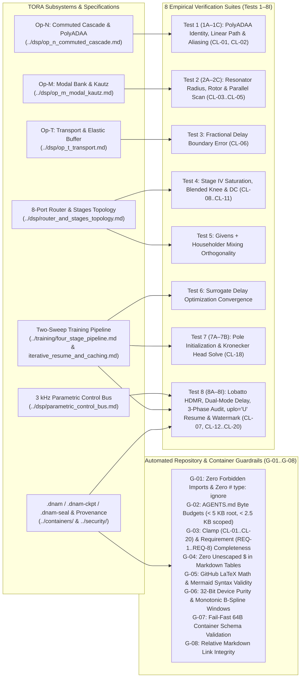

# Empirical Verification Suites (`Tests 1–8I`) & Automated Guardrails

All implementations of **Dynamic Neural Audio Modeler (DNAM)**—across the Rust real-time engine ([`packages/engine`](../../packages/engine/AGENTS.md)), Python bindings ([`packages/python`](../../packages/python/AGENTS.md)), WebAssembly runtime ([`packages/js`](../../packages/js/AGENTS.md)), and training pipeline ([`packages/trainer`](../../packages/trainer/AGENTS.md))—must pass the **8 Empirical Mathematical & Numerical Verification Suites (`Tests 1–8I`)** and the **8 Automated Repository & Container Guardrails (`G-01`–`G-08`)** specified below. For the Phase 1 design decisions and counterexample archive, see [`../rnd/tora_phase1_decisions.md`](../rnd/tora_phase1_decisions.md).

---

## 1. Master Summary of the 8 Empirical Verification Suites

| Suite ID | Subsystem Under Test | Baseline Failure Mode | Mandatory Acceptance Criterion | Reference Suites |
| :--- | :--- | :--- | :--- | :--- |
| **`Test 1` (`1A–1C`)** | Op-N Division-Free `PolyADAA`, `C²` Wavefolder & ZOH Bitcrusher (`CL-01`, `CL-02`) | Midpoint filtering droops passband; clamped-endpoint ADAA loses rail overshoot; truncating quantizer mis-rounds negatives. | `max_alg_err < 1e-12`; 6-step rail reciprocal error `< 2^-24 + 2^-44`; exact dyadic quantizer & fixed-hertz ZOH carry parity. | [`tora_operators_verification.rs`](../../packages/engine/tests/tora_operators_verification.rs), [`stage2_rail_spec_references.rs`](../../packages/engine/tests/stage2_rail_spec_references.rs), [`test_bitcrusher_spec_references.py`](../../tests/test_bitcrusher_spec_references.py) |
| **`Test 2` (`2A–2C`)** | Op-M Symplectic Resonator, Contractive Rotor, `H1` Hilbert & `T1` Tracker (`CL-03`–`CL-05`) | Cartesian pole interpolation drops `Q`; unreduced rotor exceeds unit norm in `f32`; FTZ flushes normalized `I` crossings. | `q_polar > 0.99 * q_orig`; contractive rotor `‖u_rot‖₂ ≤ 1.0` (`< 2.3e-7 rad` error); `H1` phase `-90° ± 0.34°`; `scan_err < 1e-13`. | [`tora_operators_verification.rs`](../../packages/engine/tests/tora_operators_verification.rs), [`test_op_m_spec_references.py`](../../tests/test_op_m_spec_references.py), [`test_stage1_tracker_coefficients.py`](../../tests/test_stage1_tracker_coefficients.py) |
| **`Test 3`** | Op-T Modulated Fractional Delay & Model-Declared Histories (`CL-06`) | Recursive Thiran delay filter exhibits boundary jerk under modulation; single `f32` delay loses fractional precision at `9 s`. | `err_thiran_jerk > 15.0 * err_catmull_rom_jerk`; exact 64B-aligned sizing, branchless wrap, and inward `f32` reader bounds. | [`tora_operators_verification.rs`](../../packages/engine/tests/tora_operators_verification.rs), [`test_op_t_buffer_spec_references.py`](../../tests/test_op_t_buffer_spec_references.py), [`test_passive_delay_spec_references.py`](../../tests/test_passive_delay_spec_references.py) |
| **`Test 4`** | Stage IV Spatial Tank Saturation, Blended Knee, Guard & DC (`CL-08`–`CL-11`) | Overload or DC bias destabilizes feedback loop; in-loop DC filter damps held freeze state. | `max_peak <= 0.985` (`0x3F7C28F5`); input/readout `5 Hz` DC conditioning; blended knee `< 2^-23` error; grouped max-tree decay. | [`tora_stages_and_tank_verification.rs`](../../packages/engine/tests/tora_stages_and_tank_verification.rs), [`test_feedback_guard_spec_references.py`](../../tests/test_feedback_guard_spec_references.py), [`test_captured_freeze_spec_references.py`](../../tests/test_captured_freeze_spec_references.py) |
| **`Test 5`** | Stage IV Givens + Householder Mixing `U(ψ, v)` | Non-unitary feedback mixing alters decay time across stereo modes. | `ortho_err < 1e-14` (`f64` oracle) and `< 1e-6` (`f32` runtime) across `M ∈ {4, 8, 16}` lines. | [`tora_stages_and_tank_verification.rs`](../../packages/engine/tests/tora_stages_and_tank_verification.rs) |
| **`Test 6`** | Stage IV / Op-T Surrogate Delay Gradient | Carrier-cycle local minima trap standard MSE delay optimization. | Multi-scale Gaussian envelope surrogate locks `78.42`-sample delay from `23.0` within `< 0.05` samples. | [`test_dnam_verification.py`](../../packages/trainer/tests/integration/test_dnam_verification.py) |
| **`Test 7` (`7A–7B`)** | Step-0 Initialization, Weighted Gram Contraction & Head Polish (`CL-18`) | 32-bit normal equations overflow or lose small cross-terms (`[1, 2^-25]`). | Log-octave `25 Hz..16 kHz` poles; weighted Gram error `|ĝ - g| ≤ γ_N S`; synthetic polish `esr_pol < -45 dB`. | [`test_dnam_verification.py`](../../packages/trainer/tests/integration/test_dnam_verification.py), [`test_gram_precision_spec_references.py`](../../tests/test_gram_precision_spec_references.py) |
| **`Test 8` (`8A–8I`)** | `3 kHz` Control Bus, Exact-Integer Accumulator, Outward Trust Clip, Containers & Security (`CL-07`, `CL-12`–`CL-20`) | `f32` FM sums drift over closed cycles; naive `f32` trust clip exceeds ball; non-HPKE low-order keys leak CEK. | Zero integer-accumulator drift; outward trust clip `< 1.185e-6 * ρ`; RFC 8785 JCS, `CP1`, `DAU1`/`DAI1`/`DSA1`, and HPKE verification. | [`control_accumulator_spec_references.rs`](../../packages/engine/tests/control_accumulator_spec_references.rs), [`trust_clip_spec_references.rs`](../../packages/engine/tests/trust_clip_spec_references.rs), [`signed_prefix_spec_references.rs`](../../packages/engine/tests/signed_prefix_spec_references.rs) |

---

## 2. Detailed Specification of the 8 Empirical Verification Suites

### 2.1 `Test 1` (`1A–1C`) — Division-Free Algebraic `PolyADAA`, Wavefolder & Bitcrusher (`CL-01`, `CL-02`)
1. **`Test 1A` (Linear Passband Preservation):** Verifies that separating the un-delayed linear path $\alpha_c x_c[n]$ from the $1\times$ passive B-spline `PolyADAA` blend preserves unity passband gain within `1e-12 dB` at `22 kHz` (`f_s = 48 kHz`).
2. **`Test 1B` (Division-Free Midpoint-Difference & 6-Step Rail Crossing):** Verifies exact midpoint-difference factorization (`< 1e-12` against `f64` quotients), 6-step division-free `f64` Newton reciprocal across unclamped `±1` rail crossings (`< 2^-24 + 2^-44` error in [`stage2_rail_spec_references.rs`](../../packages/engine/tests/stage2_rail_spec_references.rs)), and `C²` cubic-envelope wavefolder `PolyADAA` ($Q_1..Q_8$, [`test_stage2_spec_references.py`](../../tests/test_stage2_spec_references.py)).
3. **`Test 1C` (Cascaded Aliasing & Family 5 Bitcrusher):** Verifies multi-stage aliasing reduction and exact dyadic half-up quantization, zero/full-rate latching, and fixed-hertz `u128` reciprocal rate transfer ([`test_bitcrusher_spec_references.py`](../../tests/test_bitcrusher_spec_references.py)).

### 2.2 `Test 2` (`2A–2C`) — Op-M Symplectic Resonator, Contractive Rotor, `H1` Hilbert & `T1` Tracker (`CL-03`–`CL-05`)
1. **`Test 2A` (Radial-Polar Sweep `Q` Preservation):** Verifies radial-polar interpolation preserves `> 99%` of resonator decay proxy $1/(1-r)$ at sweep midpoints where Cartesian interpolation collapses below `10%`.
2. **`Test 2B` (Quadrant-Reduced Contractive Rotor & `Q0.192` LFO Phase, `CL-03`):** Verifies $|u_{\mathrm{rot}}|_2 \le 1.0$ across all `f32` angles in $(-\pi, \pi)$ (`< 2.3e-7 rad` error), exact `(1.0, 0.0)` zero-increment hold, and `Q0.192` slow-LFO phase progression ([`test_control_math_spec_references.py`](../../tests/test_control_math_spec_references.py), [`test_lfo_precision_spec_references.py`](../../tests/test_lfo_precision_spec_references.py)).
3. **`Test 2C` (Parallel Scan, `H1` Hilbert & `T1` Tracker):** Verifies $O(\log_2 L)$ associative scan parity (`< 1e-13`), 15-anchor `H1` Hilbert quadrature phase (`-90° ± 0.34°`, [`test_op_m_profile_bounds.py`](../../tests/test_op_m_profile_bounds.py), [`test_op_m_profile_certified_bounds.py`](../../tests/test_op_m_profile_certified_bounds.py)), `T1` DC blocker bit-exact midpoint search and conditioning ([`test_stage1_tracker_coefficients.py`](../../tests/test_stage1_tracker_coefficients.py), [`stage1_conditioning_spec_references.rs`](../../packages/engine/tests/stage1_conditioning_spec_references.rs)), and Stage III ZOH cabinet rate conversion ([`test_cabinet_modal_spec_references.py`](../../tests/test_cabinet_modal_spec_references.py), [`stage3_first_tap_spec_references.rs`](../../packages/engine/tests/stage3_first_tap_spec_references.rs)).

### 2.3 `Test 3` — Modulated Fractional Delay: Stateless 4-Tap Catmull-Rom vs. Recursive Thiran (`CL-06`)
Verifies stateless 4-tap Horner Catmull-Rom interpolation under LFO sweep (`> 15×` lower 2nd-difference boundary error than recursive Thiran), cold-allocated 64B-aligned delay sizing, branchless arbitrary-length wrap, integer-plus-`Q0.32` delay pointers with inward `f32` reader bounds, and centered `M=2` granular pitch shifting ([`test_op_t_buffer_spec_references.py`](../../tests/test_op_t_buffer_spec_references.py), [`test_passive_delay_spec_references.py`](../../tests/test_passive_delay_spec_references.py)).

### 2.4 `Test 4` — Stage IV Spatial Tank Saturation, DC & Loop Stability (`CL-08`–`CL-11`)
Verifies Stage IV unity-slope normalized cubic saturation ($V_{\text{ceil}} \le \mathtt{0x3F7C28F5}$), blended feedback knee $K(u)$ ([`test_feedback_knee_spec_references.py`](../../tests/test_feedback_knee_spec_references.py)), grouped max-tree bounded-history feedback guard ([`test_feedback_guard_spec_references.py`](../../tests/test_feedback_guard_spec_references.py)), and input/readout `5 Hz` DC conditioning (`0x3F7FD51F`) across captured freeze and play-over states ([`test_captured_freeze_spec_references.py`](../../tests/test_captured_freeze_spec_references.py)).

### 2.5 `Test 5` — Givens + Householder Stereo Mixing Matrix $\mathbf{U}(\psi, \mathbf{v})$ Orthogonality
Verifies $\Vert \mathbf{U}^\top \mathbf{U} - \mathbf{I} \Vert_\infty < 10^{-14}$ (`f64`) and vector energy preservation across Dual-Mono ($\psi = 0$), Reverb ($\psi = \pi/4$), and Ping-Pong ($\psi = \pi/2$) configurations.

### 2.6 `Test 6` — Multi-Scale Surrogate Envelope Delay Gradient Convergence
Verifies coarse-to-fine Gaussian envelope derivative surrogate convergence from `23.0` to `78.42` samples within `< 0.05` samples in 140 steps.

### 2.7 `Test 7` (`7A–7B`) — Step-0 Warm-Start, Weighted Gram Contraction & Sweep-2 Kronecker Polish (`CL-18`)
Verifies log-octave pole initialization (`Test 7A`), exact-integer / 192-bit wide-significand weighted Gram contraction bounds ($|\hat g - g| \le \gamma_N S$, [`test_gram_precision_spec_references.py`](../../tests/test_gram_precision_spec_references.py)), and joint host-`float64` Kronecker head polish (`Test 7B`).

### 2.8 `Test 8` (`8A–8I`) — Parametric Control Bus, 3-Phase Audit, `.dnam-ckpt` Resume & Provenance (`CL-07`, `CL-12`–`CL-20`)
Verifies:
- **Control Numerics & Timing (`8A–8D`):** Binary64 declared-range normalization ([`test_control_normalization_spec_references.py`](../../tests/test_control_normalization_spec_references.py)), inward `f32` physical rank bounds ([`test_control_bound_spec_references.py`](../../tests/test_control_bound_spec_references.py)), exact-integer sufficient-statistic accumulation ([`test_control_accumulator_spec_references.py`](../../tests/test_control_accumulator_spec_references.py), [`control_accumulator_spec_references.rs`](../../packages/engine/tests/control_accumulator_spec_references.rs)), outward-checked trust-region clipping ([`trust_clip_spec_references.rs`](../../packages/engine/tests/trust_clip_spec_references.rs)), bounded SPSC ingress & tick timing ([`test_ingress_publication_spec_references.py`](../../tests/test_ingress_publication_spec_references.py), [`test_control_tick_spec_references.py`](../../tests/test_control_tick_spec_references.py)), stereo-linked detector imaging ([`test_stereo_link_spec_references.py`](../../tests/test_stereo_link_spec_references.py)), and `Q64`/`Q32` tempo tracking + physical `f32` calibration inversion ([`test_tempo_clock_spec_references.py`](../../tests/test_tempo_clock_spec_references.py), [`tempo_fixed_point_spec_references.rs`](../../packages/engine/tests/tempo_fixed_point_spec_references.rs), [`test_tempo_physical_inversion_spec_references.py`](../../tests/test_tempo_physical_inversion_spec_references.py), [`test_tempo_selection_spec_references.py`](../../tests/test_tempo_selection_spec_references.py)).
- **Audit, Resume & Containers (`8E–8I`):** Non-Stop 3-Phase clamping & structured conditional selectors (`CL-15`–`CL-17`, [`test_control_condition_spec_references.py`](../../tests/test_control_condition_spec_references.py)), capture excitation & paired-stem provenance ([`test_excitation_schedule_spec_references.py`](../../tests/test_excitation_schedule_spec_references.py), [`test_paired_capture_spec_references.py`](../../tests/test_paired_capture_spec_references.py)), `CP1` packed contributor projections ([`test_control_projection_spec_references.py`](../../tests/test_control_projection_spec_references.py)), tier-bundled `.dnam-ckpt` `DCA1` framing and `DNAM-GRAM-INPUT-v1` fingerprinting ([`test_checkpoint_wire_spec_references.py`](../../tests/test_checkpoint_wire_spec_references.py)), RFC 8785 JCS header canonicalization ([`immutable_header_jcs_spec_references.rs`](../../packages/engine/tests/immutable_header_jcs_spec_references.rs)), `DAU1`/`DAI1`/`DSA1`/`DNPL` + RFC 9180 HPKE envelopes ([`signed_prefix_spec_references.rs`](../../packages/engine/tests/signed_prefix_spec_references.rs), [`encrypted_record_spec_references.rs`](../../packages/engine/tests/encrypted_record_spec_references.rs)), license-scoped watermark seeds ([`test_watermark_spec_references.py`](../../tests/test_watermark_spec_references.py)), and `DMU1`/`DME1` mutable suffixes ([`open_mutable_spec_references.rs`](../../packages/engine/tests/open_mutable_spec_references.rs)).

---

## 3. Phase 1 Design Closure & Verification Gate Taxonomy

All Phase 1 specification and design choices are finalized in their canonical `docs/` files, with R&D trade-offs and counterexamples archived in [`../rnd/tora_phase1_decisions.md`](../rnd/tora_phase1_decisions.md):
- **Phase 2 Gates (Rust Engine):** Production realization and unit/property/differential verification of all operators (`Op-T`, `Op-M`, `Op-N`), Stage 0–IV routing, `3 kHz` control bus, `2.0` containers, and `≥ 95%` line coverage in `packages/engine/`.
- **Phase 3–5 Gates (SDKs, Trainer & Studio):** PyO3/WASM SDK bindings, 32-bit accelerator forward/Gram parity, two-sweep training, `.dnam-ckpt` resume, and Studio capture/UI integration.
- **Phase 6 Gates (Target Hardware & Perceptual Certification):** End-to-end `bESR` / `MR-STFT` / `LTAS` / `SegESR` device benchmarks, RK3582 Cortex-A76 WCET and State RAM verification (`REQ-6.1`), and hardware TrustZone enclave validation.

---

## 4. Canonical TORA Requirement Verification Matrix (`REQ-1`–`REQ-8.8`)

| Goal ID | Requirement Domain | TORA Architectural Realization & Verification Scope | Status |
| :--- | :--- | :--- | :---: |
| **`REQ-1`** | **Model Classes & Accuracy** | `Op-T`, `Op-M`, and `Op-N` across Stages 0–IV and the 256-D Mid/Side Kronecker head; full-device accuracy verified in Phase 6. | `Partial` |
| **`REQ-1.5`** | **Full-Rig Multi-Control Modeling** | Packed tier-local `CP1` projections (`8-D` Rank-4 in `Lite..Pro`, `16-D` Rank-8 + `16×4` stage-dispatch delta in `Ultra`). | `Partial` |
| **`REQ-2`** | **Quality, Control Bus & Tempo Sync** | Per-output noise-adjusted `bESR`, `MR-STFT`, 33-band `LTAS`, and duration-weighted `SegESR` with non-stop 3-phase clamping. | `Partial` |
| **`REQ-2.5`** | **MIDI / Host Tempo Sync** | `20–400 BPM` `Q64`/`Q32` tempo tracking across 12 subdivisions, reachable `f32` physical inversion, and `SmoothRelock` / `ImmediatePhaseLock`. | `Partial` |
| **`REQ-3`** | **Continuous Checkpointing & Stem Resume** | Tier-bundled `.dnam-ckpt` (`DCA1`), `uplo='U'` `Arena 4` slices, SHA-256 Gram-input fingerprint, and windowed `< 32 MiB` refresh. | `Partial` |
| **`REQ-4`** | **Accelerator-First, Accurate & Memory-Scaled Training** | 32-bit device streaming, weighted Gram contraction bound (`|ĝ - g| ≤ γ_N S`), batched host `float64` solver, and `< 8 GiB` host budget. | `Partial` |
| **`REQ-5`** | **Multi-Tier Slimmable Scaling** | Four nested tiers (`Lite ⊂ Full ⊂ Pro ⊂ Ultra`), single-run joint training, on-demand bounded tier crossfade, and keyless prefix stripping. | `Partial` |
| **`REQ-6`** | **Embedded Real-Time Execution** | `≥ 10× Lite`, `≥ 6× Full`, `≥ 2× Pro` @ `48 kHz` on `1×` Cortex-A76, zero real-time `FDIV`/`FSQRT`/`libm`, and zero callback allocations. | `Partial` |
| **`REQ-7`** | **Unclipped `f32` Signal Chain, Topologies & Stability** | `±100.0` (`+40 dBFS`) certified unclipped envelope, `±1e9` all-finite safety guards, `1→1`/`2→1`/`1→2`/`2→2` topologies, and `CL-01`–`CL-20`. | `Partial` |
| **`REQ-8.1`** | **Cryptographic Provenance & Preset-Safe Metadata** | RFC 8785 JCS `immutable_header_sha256`, `DAU1`/`DAI1`/`DSA1` `Ed25519` prefix commitments, and growable `DMU1`/`DME1` + `DMUE` suffix. | `Partial` |
| **`REQ-8.2`** | **Creator-Signed Distribution Policy & OEM Exclusivity** | Signed `metadata.distribution_policy` (`allowed_protection_profiles`, `allowed_oem_vendors`) enforced at issuance and load time. | `Partial` |
| **`REQ-8.3`** | **Graduated Protection Profiles & OEM Integration** | `Open`, `DeviceAllowlisted`, and `EnclaveSealed` profiles with V2 `OemDeviceCertificate` signing and RFC 9180 HPKE recipient slots. | `Partial` |
| **`REQ-8.4`** | **Offline Stage Reliability & Zero Real-Time Overhead** | Indefinite offline authorization for issued protected models; all verification and decryption complete on the cold load path (`0` audio flops). | `Partial` |
| **`REQ-8.5`** | **Buyer Watermarking** | Dual-mechanism buyer watermark (Stage III reciprocal gauge + Stage II Coupled Tardos code) with `DNAM-WM-*-SEED-V1` HMAC derivation. | `Partial` |
| **`REQ-8.6`** | **Anti-Cloning Gate & Evidence-Based Revocation** | 3-stage ingestion gate (signatures + Stage III gauge-invariant component + synthetic chirp probe); revocation requires independent source evidence. | `Partial` |
| **`REQ-8.7`** | **Interactive Storefront Auditioning (`.dnam-prev`)** | `Lite`-only `.dnam-prev` omitting `Full..Ultra`, `P=1` bounded window, `P≥2` fixed-anchor rank-`r` containment, and `3 kHz` probe guard. | `Partial` |
| **`REQ-8.8`** | **Declarative, Code-Execution-Free Containers** | 64B-aligned declarative `.dnam`, `.dnam-ckpt`, `.dnam-seal`, `.dnam-prev`, and `.dnce` formats with zero `pickle` execution. | `Partial` |

---

## 5. Automated Repository, Documentation & Container Guardrails (`G-01`–`G-08`)

Enforced on every commit and CI run by the top-level project guardrail suite ([`tests/test_guardrails.py`](../../tests/test_guardrails.py), `moon check tests`), package guardrail tests ([`packages/trainer/tests/test_guardrails.py`](../../packages/trainer/tests/test_guardrails.py)), and container validation suites:

| Guardrail ID | Verification Test / Module | Enforced Architectural / Documentation Invariant |
| :--- | :--- | :--- |
| **`G-01`** | `test_zero_forbidden_imports_and_zero_type_ignore` ([`packages/trainer/tests/test_guardrails.py`](../../packages/trainer/tests/test_guardrails.py)) | Zero forbidden heavy imports (`scipy`, `pandas`, `matplotlib`, `soundfile`) and zero `# type: ignore` / `# pyrefly: ignore` directives across `packages/trainer/src/` and `packages/trainer/tests/`. |
| **`G-02`** | `test_progressive_disclosure_agents_md_byte_limits` ([`tests/test_guardrails.py`](../../tests/test_guardrails.py)) | Root [`AGENTS.md`](../../AGENTS.md) must remain strictly `< 5,000 B` and every scoped `packages/**/AGENTS.md` and [`tests/AGENTS.md`](../../tests/AGENTS.md) must remain `< 2,500 B` (routing maps only; zero duplicated equations). |
| **`G-03`** | `test_clamp_and_requirement_registries_documented` ([`tests/test_guardrails.py`](../../tests/test_guardrails.py)) | [`../CONTRIBUTING.md`](../CONTRIBUTING.md) must exist, [`../training/clamp_and_audit_registry.md`](../training/clamp_and_audit_registry.md) must document all canonical clamps (`CL-01` through `CL-20`) with existing target module paths on disk, and [`../overview/system_goals_and_requirements.md`](../overview/system_goals_and_requirements.md) must document all 40 requirements (`REQ-1.1` through `REQ-8.8`) in canonical table rows with strictly implementation-agnostic normative text. |
| **`G-04`** | `test_no_inline_latex_math_in_markdown_tables` ([`tests/test_guardrails.py`](../../tests/test_guardrails.py)) | No Markdown table row (any line starting with `\|`) in any `.md` file may contain raw `$` delimiters outside backticks `` `...` `` (prevents table pipe `\|` vs. math delimiter parser collisions). |
| **`G-05`** | `test_valid_github_latex_math_across_docs` ([`tests/test_guardrails.py`](../../tests/test_guardrails.py)) | All `$...$` and `$$...$$` blocks across the repository must use strict GitHub/MathJax-compatible LaTeX (balanced braces, no `\operatorname`, no punctuation escapes `\_`, `\;`, `\,`, `\{`, `\}`, `\|`, no underscores inside `\text{...}`), and no semicolons `;` inside Mermaid `sequenceDiagram` blocks. |
| **`G-06`** | `test_device_32bit_only_and_no_legacy_window_tables` ([`packages/trainer/tests/test_guardrails.py`](../../packages/trainer/tests/test_guardrails.py)) | Zero 64-bit (`float64`/`complex128`/`int64`) device tensor allocations and zero hardcoded `500_000`-sample window tables across `dsp/{op_t,op_m,op_n,router,stage1_pre,stage2_cascade,stage3_cabinet,stage4_tank,head_kronecker}.py` and `training/{step0_sysid,sweep1_cascade,sweep2_tank,polish_head,pipeline}.py`. |
| **`G-07`** | `test_8h` & `test_8i` ([`test_dnam_verification.py`](../../packages/trainer/tests/integration/test_dnam_verification.py)) | `.dnam`, `.dnam-ckpt`, and `.dnam-seal` loaders fail fast with explicit errors on invalid magic bytes, `CRC32C` mismatch, unaligned arena offsets (`% 64 != 0`), or invalid channel counts (`C not in {4, 8, 12, 16}`). |
| **`G-08`** | `test_relative_markdown_links_resolve` ([`tests/test_guardrails.py`](../../tests/test_guardrails.py)) | Every relative Markdown file link and `#section-anchor` fragment across `AGENTS.md`, `README.md`, `CONTRIBUTING.md`, `CLA.md`, `docs/**/*.md`, `tests/**/*.md`, and `packages/**/*.md` resolves to an existing file/directory and GitHub heading slug on disk. |
