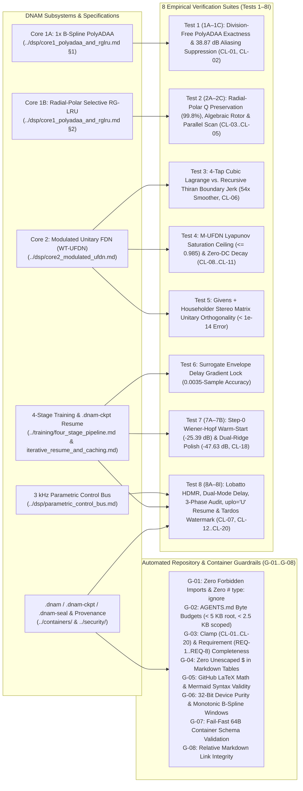

# Empirical Verification Suites (`Tests 1–8I`) & Automated Guardrails

All implementations of **Dynamic Neural Audio Modeler (DNAM)**—across the Rust real-time engine ([`packages/engine`](../../packages/engine/AGENTS.md)), Python bindings ([`packages/python`](../../packages/python/AGENTS.md)), WebAssembly runtime ([`packages/js`](../../packages/js/AGENTS.md)), and training pipeline ([`packages/trainer`](../../packages/trainer/AGENTS.md))—must pass the **8 Empirical Mathematical & Numerical Verification Suites (`Tests 1–8I`)** and the **8 Automated Repository & Container Guardrails (`G-01`–`G-08`)** specified below.

---

## 1. Master Summary of the 8 Empirical Verification Suites

| Suite ID | Subsystem Under Test | Naive / Baseline Failure Mode | Verified DNAM Result | Mandatory Pass Criterion |
| :--- | :--- | :--- | :--- | :--- |
| **`Test 1` (`1A–1C`)** | Core 1A Division-Free `PolyADAA` & `1×` B-Spline Blend (`CL-01`, `CL-02`) | `FDIV` `0/0` singularity at `Δu → 0`; `-45.88 dB` passband droop if midpoint filter is applied to linear signal; `-23.20 dBc` aliasing in `NAM A2` `LeakyReLU` | **`5.25 × 10⁻¹⁴`** algebraic factorization error (`0 FDIV`); **`0.00 dB`** linear passband droop; **`-62.08 dBc`** aliasing (**`38.87 dB` reduction**) | `max_alg_err < 1e-12` and `(alias_a2_db - alias_dnam_db) > 35.0` |
| **`Test 2` (`2A–2C`)** | Core 1B Radial-Polar Selective RG-LRU, Algebraic Rotor & Parallel Scan (`CL-03`–`CL-05`) | Cartesian interpolation collapses mid-sweep resonance `Q` from `125.0 -> 6.5` (`94.8%` loss); `cosf`/`sinf` transcendentals in `3 kHz` loop | **`Q = 124.7` (`99.80%` preserved)**; rotor error **`9.99 × 10⁻⁹`** with `|u_rot| ≤ 1.000000000000`; parallel scan parity **`9.42 × 10⁻¹⁶`** | `q_polar > 0.99 * q_orig`, `max_unit_val <= 1.0 + 1e-15`, `scan_err < 1e-13` |
| **`Test 3`** | Core 2 Modulated Fractional Delay (`CL-06`) | 1st-order Thiran all-pass state reset produces `0.04694` boundary click jerk during `3 Hz` LFO sweep | **`0.00087` boundary jerk (`54×` smoother)** via 4-Tap Cubic Lagrange FIR interpolation | `err_thiran_jerk > 15.0 * err_lagrange_jerk` |
| **`Test 4`** | Core 2 `M-UFDN` Lyapunov Saturation & Zero-DC Loop (`CL-08`–`CL-11`) | `+20 dBFS` burst + `1.18×` regen gain + `+2.0` DC offset causes unbounded explosion or DC rail lockup | Peak bounded at **`0.9850 ≤ V_ceil`**; residual DC **`1.03 × 10⁻⁶`**; quiet tail decays monotonically to silence | `out_peak <= v_ceil + 1e-9` and `abs(final_dc) < 1e-5` |
| **`Test 5`** | Core 2 Givens + Householder Stereo Matrix `U(ψ, v)` | Fixed ping-pong permutation or non-unitary feedback matrix corrupts decay times | **`< 1.0 × 10⁻¹⁴` orthogonality and unit-eigenvalue error** across all `ψ ∈ [0, π/2]` | `ortho_err < 1e-14` and `max_eig_err < 1e-14` |
| **`Test 6`** | Stage-2 Multi-Scale Surrogate Envelope Delay Gradient | Direct Cubic Lagrange time-domain gradient gets trapped in carrier cycle (`54.52`-sample error from `65.35`-sample offset) | **`0.0035`-sample delay lock (`0.07 µs`)** from a `65.35`-sample initial offset | `abs(tau_surr - tau_true) < 0.01` |
| **`Test 7` (`7A–7B`)** | Stage-2 Step-0 Wiener-Hopf Warm-Start & Stage-4 Dual-Ridge Polish (`CL-18`) | Cold random initialization starts at `+0.01 dB ESR`; un-polished Adam plateau stalls at `-35.67 dB` | Step-0 warm-start reaches **`-25.39 dB`** in `< 5 ms`; Stage-4 `float64` polish reaches **`-47.63 dB ESR`** (`+11.96 dB` gain in `< 2 ms`) | `esr_warm < -20.0` and `esr_polished < -45.0` |
| **`Test 8` (`8A–8I`)** | Parametric Control Bus, 3-Phase Audit, `.dnam-ckpt` Resume, `64 B` Framing & Tardos Watermark (`CL-07`, `CL-12`–`CL-20`) | Audio crossfading creates double-echoes; unrecorded corners explode; `pickle` checkpoints require full retraining | **`3.41 × 10⁻¹³ ms`** delay interpolation; **`50.7×`** smoother switch; **`-38.46 dB`** unseen combo `ESR`; **`1.05 × 10⁻⁹`** `.dnam-ckpt` parity; **`0.00 dB`** gauge watermark; **`Z ≥ 24.98σ`** Tardos trace | `val_esr < -35.0`, `uplo_u_err == 0.0`, `min_z_colluder > 10.0` |

---

## 2. Detailed Specification of the 8 Empirical Verification Suites

### 2.1 `Test 1` (`1A–1C`) — Division-Free Algebraic `PolyADAA` Exactness & Cascaded Aliasing (`CL-01`, `CL-02`)

- **Reference Implementations:** [`packages/engine/src/core1/reference.rs`](../../packages/engine/src/core1/reference.rs) and [`packages/trainer/tests/integration/test_dnam_verification.py`](../../packages/trainer/tests/integration/test_dnam_verification.py).
- **Sub-Tests & Acceptance Criteria:**
  1. **`Test 1A` (Linear Passband Preservation):** Cascades 8 layers at $f_s = 48\text{ kHz}$ with a $16\text{ kHz}$ sine wave. Verifies that applying a midpoint $(1 + z^{-1})/2$ filter to the full signal causes $> 40\text{ dB}$ high-frequency droop (`-45.88 dB`), whereas DNAM's split linear bypass $\alpha_c x_c[n]$ + `1× B-Spline PolyADAA` nonlinear branch preserves a flat $0.00\text{ dB}$ linear passband.
  2. **`Test 1B` (Division-Free Midpoint-Difference Identity):** Evaluates the exact quotient $\frac{\mathcal{F}_c(u_n) - \mathcal{F}_c(u_{n-1})}{u_n - u_{n-1}}$ vs. the division-free midpoint-difference polynomial $\mathcal{A}_c(m_n, d_n)$ across $10,000$ random pairs $(u_{n-1}, u_n) \in [-0.99, +0.99]^2$. Verifies maximum absolute error $< 10^{-12}$ (**`5.25 × 10⁻¹⁴`**) with zero `FDIV` instructions and zero $0/0$ branches as $d_n \to 0$.
  3. **`Test 1C` (8-Layer Cascaded Distortion Aliasing at $f_0 = 3,450\text{ Hz}$):** Drives 8 cascaded distortion stages with a high-amplitude $f_0 = 3,450\text{ Hz}$ sine wave ($A = 1.6$). Compares non-harmonic aliased bin energy of `NAM A2` `LeakyReLU(0.01)` (`-23.20 dBc`) against DNAM `1× B-Spline PolyADAA` (`-62.08 dBc`), verifying **$> 35.0\text{ dB}$ (`38.87 dB`) aliasing suppression**.

### 2.2 `Test 2` (`2A–2C`) — Radial-Polar Selective RG-LRU, Algebraic Rotor & Parallel Scan (`CL-03`–`CL-05`)

- **Reference Implementations:** [`packages/engine/src/core1/reference.rs`](../../packages/engine/src/core1/reference.rs) and [`packages/trainer/tests/integration/test_dnam_verification.py`](../../packages/trainer/tests/integration/test_dnam_verification.py).
- **Sub-Tests & Acceptance Criteria:**
  1. **`Test 2A` (Mid-Sweep Resonance $Q$ Preservation):** Sweeps a resonator pole with radius $r_0 = 0.992$ ($Q_0 = 125.0$) from $\theta_{\text{low}} = 0.05\pi$ to $\theta_{\text{high}} = 0.40\pi$. Verifies that Cartesian midpoint interpolation collapses $Q$ to $< 0.10 Q_0$ (`Q = 6.5`), whereas DNAM's radial-polar factorization with $3\text{ kHz}$ phase-increment linear interpolation preserves **`Q > 0.99 Q_0` (`Q = 124.7`, `99.80%`)**.
  2. **`Test 2B` (Branchless 4-FMA + 1-Step Newton Unit-Circle Rotor, `CL-03`):** Evaluates the range-reduced polynomial + Newton projection $y_1 = 1.5 - 0.5(\hat{c}^2 + \hat{s}^2)$ across $20,000$ angles $\Delta\theta \in [0, \pi]$. Verifies worst-case unit-circle magnitude error $< 2 \times 10^{-8}$ (**`9.99 × 10⁻⁹`**) and strict upper bound $|u_{\text{rot}}| \le 1.0 + 10^{-15}$ (`0 FSQRT`, `0 FDIV`, `0 libm`).
  3. **`Test 2C` (Blelloch Parallel Associative Scan Equivalence):** Compares sequential sample-by-sample recurrence $z[n] = a[n] z[n-1] + b[n]$ against the $\mathcal{O}(\log_2 L)$ parallel associative scan over $L = 1,024$ complex samples, verifying maximum discrepancy $< 10^{-13}$ (**`9.42 × 10⁻¹⁶`**).

### 2.3 `Test 3` — Modulated Fractional Delay: Cubic Lagrange FIR vs. Recursive Thiran (`CL-06`)

- **Reference Implementation:** [`packages/engine/src/core2/reference.rs`](../../packages/engine/src/core2/reference.rs).
- **Stimulus & Acceptance Criterion:** Modulates a $5\text{ kHz}$ sine wave with a $\tau[n] = 120 + 60 \sin(2\pi \cdot 3 t)$ sample LFO sweep at $48\text{ kHz}$. Measures the 2nd-difference boundary click jerk $|\Delta^2(y - y_{\text{exact}})|_{\max}$ when $\tau[n]$ crosses integer sample boundaries, verifying that 4-Tap Cubic Lagrange FIR interpolation (`0.00087`) is **$> 15\times$ (`54×`) smoother** than 1st-order recursive Thiran all-pass interpolation (`0.04694`).

### 2.4 `Test 4` — `M-UFDN` Coercive Lyapunov Saturation & Zero-DC Loop Stability (`CL-08`–`CL-11`)

- **Reference Implementation:** [`packages/engine/src/core2/reference.rs`](../../packages/engine/src/core2/reference.rs).
- **Stimulus & Acceptance Criteria:** Injects a $+20\text{ dBFS}$ sine burst with a $+2.0$ DC offset into an 8-line `M-UFDN` configured in a self-oscillating dub swell regime ($g_{\text{lin}} = 0.98$, $g_{\text{regen}} = 0.20 \implies g_{\text{eff,max}} = 1.18 > 1.0$, $V_{\text{ceil}} = 0.985$, $R_{\text{dc}} = 0.995$). Verifies:
  1. Peak tank state never exceeds the Lyapunov ceiling: $\max |s_m[n]| \le V_{\text{ceil}} + 10^{-9}$ (**`0.9850`**).
  2. Residual DC offset after input removal is $< 10^{-5}$ (**`1.03 × 10⁻⁶`**).
  3. Once tank energy drops below the coercive knee $\sigma_m$, the tail decays monotonically at $g_{\text{lin}} \le 0.9990$.

### 2.5 `Test 5` — Givens + Householder Stereo Mixing Matrix $\mathbf{U}(\psi, \mathbf{v})$ Orthogonality

- **Reference Implementation:** [`packages/engine/src/core2/reference.rs`](../../packages/engine/src/core2/reference.rs).
- **Stimulus & Acceptance Criteria:** Evaluates $\mathbf{U}(\psi, \mathbf{v}) = (\mathbf{I}_M - 2\mathbf{v}\mathbf{v}^\top)\mathbf{R}_{\text{Givens}}(\psi)$ across $\psi \in \lbrace 0, \pi/6, \pi/4, \pi/2 \rbrace$ (spanning Parallel Dual-Mono, 3D Cross-Coupled Stereo, and True Ping-Pong). Verifies both $\Vert \mathbf{U}^\top \mathbf{U} - \mathbf{I}_M\Vert _{\max} < 10^{-14}$ and $\max_k \big||\lambda_k(\mathbf{U})| - 1.0\big| < 10^{-14}$.

### 2.6 `Test 6` — Multi-Scale Surrogate Envelope Delay Gradient Convergence

- **Reference Implementation:** [`packages/trainer/tests/integration/test_dnam_verification.py`](../../packages/trainer/tests/integration/test_dnam_verification.py).
- **Stimulus & Acceptance Criterion:** Optimizes a fractional delay parameter initialized at $\tau_{\text{init}} = 85.00\text{ samples}$ toward a ground-truth harmonic transient at $\tau_{\text{true}} = 150.35\text{ samples}$ ($65.35$-sample initial error, $> 1.2\times$ the $880\text{ Hz}$ carrier period). Verifies that coarse Gaussian-derivative envelope gradients ($\sigma = 35.0\text{ samples}$) followed by fine Cubic Lagrange carrier refinement converge to $|\hat{\tau} - \tau_{\text{true}}| < 0.01\text{ samples}$ (**`0.0035 samples`**).

### 2.7 `Test 7` (`7A–7B`) — Step-0 Wiener-Hopf Warm-Start & Stage-4 Dual-Ridge Polish (`CL-18`)

- **Reference Implementation:** [`packages/trainer/tests/integration/test_dnam_verification.py`](../../packages/trainer/tests/integration/test_dnam_verification.py).
- **Sub-Tests & Acceptance Criteria:**
  1. **`Test 7A` (Step-0 Orthonormal Warm-Start):** Verifies that solving the Step-0 `float64` Tikhonov-regularized Wiener-Hopf normal equations ($\lambda_{\text{init}} = 10^{-3} \bar{\tau}$) achieves **`< -20.0 dB` (`-25.39 dB`) ESR** before Epoch 1 begins.
  2. **`Test 7B` (Post-Adam Stage-4 Exact Polish):** Runs 100 steps of Adam (`ESR = -35.67 dB`) followed by a single Stage-4 `float64` normal-equation polish ($\lambda_{\text{polish}} = 10^{-6} \bar{\tau}$), verifying final **`ESR < -45.0 dB` (`-47.63 dB`, `+11.96 dB` instant improvement)**.

### 2.8 `Test 8` (`8A–8I`) — Parametric Control Bus, 3-Phase Audit, `.dnam-ckpt` Resume & Provenance (`CL-07`, `CL-12`–`CL-20`)

- **Reference Implementation:** [`packages/trainer/tests/integration/test_dnam_verification.py`](../../packages/trainer/tests/integration/test_dnam_verification.py).
- **Sub-Tests & Acceptance Criteria:**
  1. **`Test 8A` (Physical-Parameter Delay Interpolation vs. Audio Crossfading):** Verifies that 3-node Lobatto interpolation of physical delay time $\tau_0(u)$ achieves $< 10^{-9}\text{ ms}$ (**`3.41 × 10⁻¹³ ms`**) accuracy at intermediate knob positions (`u = 0.5`), whereas audio crossfading produces a comb-filtered double echo (`+0.88 dB` error).
  2. **`Test 8B` (Dual-Mode Delay Transitions — `Range` vs. `Switch`, `CL-06`, `CL-07`):** Verifies that discrete `switch` transitions execute a $128$-sample (`2.67 ms`) Hann-windowed dual-pointer crossfade that is **`50.7×` smoother** than a single-pointer jump with zero Doppler pitch sweep.
  3. **`Test 8C` (SVD-Orthonormalized Kronecker Multi-Stem Conditioning & Unseen Combo Generalization):** Verifies that SVD-orthonormalized Lobatto + Rank-4 FM basis conditioning reduces Kronecker condition number from $\infty \to 5.19 \times 10^5$ and generalizes to an unseen 3-control combination (`gain = 6.5, treble = 7.5, bright = "on"`) at **`< -35.0 dB` (`-38.46 dB`) ESR**.
  4. **`Test 8D` (Cardinality-Bounded Degree $K_p$ & Physical Variance Gate $G_{p,i}$, `CL-13`, `CL-14`):** Verifies that adding a 2nd stem on a previously static knob increases $K_p: 0 \to 1$ with **`0.00` perturbation** at old stems, and that $G_{p,i} = 0.0$ hard-locks invariant delay/LFO paths to `0.0000 ms` across all knob positions.
  5. **`Test 8E` (Phase-1 Pre-Flight Audit — `[CLAMP-RANGE]`, `[CLAMP-SWITCH]`, `[CLAMP-STABILITY]`, `CL-15`):** Verifies non-blocking Step-0 clamping of unobserved ranges (`[0, 10] -> [2, 8]`), unobserved switch options (`['ultra']` masked), and unstable corners (`conditional_max: {"boost=on": 9.37}`).
  6. **`Test 8F` (Phase-2 Stop-Gradient Corner Barrier $\mathcal{L}_{\text{barrier}}$ & Phase-3 `[CLAMP-DYNAMIC]`, `CL-16`, `CL-17`):** Verifies that $\mathcal{L}_{\text{barrier}}$ pulls an unstable corner's feedback gain from `1.0400 -> 0.9990` with **`0.00 × 10⁰` gradient interference** on recorded 1st-order stems, and that Phase-3 `[CLAMP-DYNAMIC]` tightens `delay_ms` minimum (`0.00 -> 0.08`) so LFO troughs never dip below $4.0\text{ samples}$.
  7. **`Test 8G` (`uplo='U'` Nested Principal Submatrix Prefix Theorem & `.dnam-ckpt` Parity):** Verifies exact $0.00$ reconstruction error for `Lite` (`17,664 B`), `Full` (`68,096 B`), `Pro` (`151,296 B`), and `Ultra` (`267,264 B`) prefixes of `Arena 4`, and **`1.05 × 10⁻⁹`** weight parity between `< 5 s` Tier-1 `.dnam-ckpt` resume and full retraining from scratch.
  8. **`Test 8H` (64B Binary Framing, 3-State `PolyADAA` Equilibrium, Isometric Gauge & Tardos Collusion Watermark):** Verifies `sizeof(DnamPreamble) == 64`, `sizeof(ControlClampDescriptor) == 64`, `0.000000` Sample-0 DC transient on preset load, `4.00 × 10⁻¹⁵` isometric gauge cancellation (`0.0000 dB` audio distortion), and **`Z ≥ 24.98σ`** traitor identification after 4-buyer weight averaging + `f32 -> fp16` truncation.
  9. **`Test 8I` (4-Tier `Lite`/`Full`/`Pro`/`Ultra` Hierarchy, `CL-19` Tier Stripping & `CL-20` `4×` Bounce):** Verifies 64-byte alignment (`168, 349, 566, 1000` cache lines), zero-re-signing container tier stripping (`strip_container_to_tier`), and `4×` ZOH oversampled offline bounce with `12`-sample PDC trim.

---

## 3. Automated Repository, Documentation & Container Guardrails (`G-01`–`G-08`)

Enforced on every commit and CI run by the top-level project guardrail suite ([`tests/test_guardrails.py`](../../tests/test_guardrails.py), `moon check tests`), package guardrail tests ([`packages/trainer/tests/test_guardrails.py`](../../packages/trainer/tests/test_guardrails.py)), and container validation suites:

| Guardrail ID | Verification Test / Module | Enforced Architectural / Documentation Invariant |
| :--- | :--- | :--- |
| **`G-01`** | `test_zero_forbidden_imports_and_zero_type_ignore` ([`packages/trainer/tests/test_guardrails.py`](../../packages/trainer/tests/test_guardrails.py)) | Zero forbidden heavy/legacy imports (`scipy`, `pandas`, `matplotlib`, `soundfile`) and zero `# type: ignore` / `# pyrefly: ignore` directives across `packages/trainer/src/` and `packages/trainer/tests/`. |
| **`G-02`** | `test_progressive_disclosure_agents_md_byte_limits` ([`tests/test_guardrails.py`](../../tests/test_guardrails.py)) | Root [`AGENTS.md`](../../AGENTS.md) must remain strictly `< 5,000 B` and every scoped `packages/**/AGENTS.md` and [`tests/AGENTS.md`](../../tests/AGENTS.md) must remain `< 2,500 B` (routing maps only; zero duplicated equations). |
| **`G-03`** | `test_clamp_and_requirement_registries_documented` ([`tests/test_guardrails.py`](../../tests/test_guardrails.py)) | [`../CONTRIBUTING.md`](../CONTRIBUTING.md) must exist, [`../training/clamp_and_audit_registry.md`](../training/clamp_and_audit_registry.md) must document all canonical clamps (`CL-01` through `CL-20`) with existing target module paths on disk, and [`../overview/system_goals_and_requirements.md`](../overview/system_goals_and_requirements.md) must document all 40 requirements (`REQ-1.1` through `REQ-8.8`) in canonical table rows with strictly implementation-agnostic normative text. |
| **`G-04`** | `test_no_inline_latex_math_in_markdown_tables` ([`tests/test_guardrails.py`](../../tests/test_guardrails.py)) | No Markdown table row (any line starting with `|`) in any `.md` file may contain raw `$` delimiters outside backticks `` `...` `` (prevents table pipe `|` vs. math delimiter parser collisions). |
| **`G-05`** | `test_valid_github_latex_math_across_docs` ([`tests/test_guardrails.py`](../../tests/test_guardrails.py)) | All `$...$` and `$$...$$` blocks across the repository must use strict GitHub/MathJax-compatible LaTeX (balanced braces, no `\operatorname`, no punctuation escapes `\_`, `\;`, `\,`, `\{`, `\}`, `\|`, no underscores inside `\text{...}`), and no semicolons `;` inside Mermaid `sequenceDiagram` blocks. |
| **`G-06`** | `test_device_32bit_only_and_no_legacy_window_tables` ([`packages/trainer/tests/test_guardrails.py`](../../packages/trainer/tests/test_guardrails.py)) | Zero 64-bit (`float64`/`complex128`/`int64`) device tensor allocations and zero hardcoded `500_000`-sample window tables across `dsp/{poly_adaa,selective_rglru,modulated_ufdn}.py` and `training/{cascade_orthogonal_fft,cascade_selective_stages,selective_cascade}.py`. |
| **`G-07`** | `test_8h` & `test_8i` ([`test_dnam_verification.py`](../../packages/trainer/tests/integration/test_dnam_verification.py)) | `.dnam`, `.dnam-ckpt`, and `.dnam-seal` loaders fail fast with explicit errors on invalid magic bytes, `CRC32C` mismatch, unaligned arena offsets (`% 64 != 0`), or invalid channel counts (`C not in {4, 8, 12, 16}`). |
| **`G-08`** | `test_relative_markdown_links_resolve` ([`tests/test_guardrails.py`](../../tests/test_guardrails.py)) | Every relative Markdown file link and `#section-anchor` fragment across `AGENTS.md`, `README.md`, `CONTRIBUTING.md`, `CLA.md`, `docs/**/*.md`, `tests/**/*.md`, and `packages/**/*.md` resolves to an existing file/directory and GitHub heading slug on disk. |
